  <picture>
    <source media="(max-width: 600px)" srcset="assets/m/hero.svg">
    
  </picture>

  
  

### `~/infra`

  <picture>
    <source media="(max-width: 600px)" srcset="assets/m/how-i-ship.svg">
    
  </picture>

### `~/projects`

  <picture>
    <source media="(max-width: 600px)" srcset="assets/m/projects.svg">
    
  </picture>

  
  

  
  

<code>$ ls ~/projects</code> · <a href="https://github.com/GospodinovPetar/CineMatch">CineMatch</a> (⭐ 7) · <a href="https://github.com/GospodinovPetar/vehicleReservations">vehicleReservations</a> · <a href="https://github.com/GospodinovPetar?tab=repositories">everything else →</a>

### `~/dotfiles/stack.yaml`

  <picture>
    <source media="(max-width: 600px)" srcset="assets/m/stack.svg">
    
  </picture>

### `~/history`

  <picture>
    <source media="(max-width: 600px)" srcset="assets/m/history.svg">
    
  </picture>

  

  <picture>
    <source media="(max-width: 600px)" srcset="assets/m/footer.svg">
    
  </picture>

